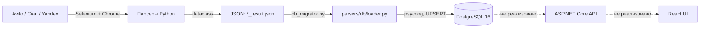

# Обзор стека технологий

Документ фиксирует **фактическое** состояние репозитория на текущий момент и сопоставляет его
с целевым стеком из [`Stack.md`](Stack.md). Источники: [`docker-compose.yml`](docker-compose.yml),
[`.env.example`](.env.example), [`parsers/pyproject.toml`](parsers/pyproject.toml),
[`backend/Backend.csproj`](backend/Backend.csproj), [`backend/Program.cs`](backend/Program.cs),
[`postgres/init/init_db.sql`](postgres/init/init_db.sql).

---

## 1. Краткий вывод

| Слой | Заявлено в `Stack.md` | Фактически в репозитории | Готовность |
| --- | --- | --- | --- |
| База данных | PostgreSQL | PostgreSQL 16 в Docker + схема `init_db.sql` (24 таблицы) | ✅ в основном готово |
| Парсеры | 3 парсера на Python | Avito, Cian, Yandex на Selenium + BS4, запись в JSON | ✅ работает, требует доработки качества данных |
| Загрузка в БД | `data-processor` | Пакет `parsers/db/` + CLI `db_migrator.py` | 🟡 частично (нет дедупликации) |
| Очередь | Kafka | отсутствует | ❌ нет |
| API | ASP.NET Core | .NET 10 Minimal API, только `Hello World` | ❌ скелет |
| Frontend | React | отсутствует | ❌ нет |
| Прокси | Nginx | отсутствует | ❌ нет |
| Контейнеризация | Docker Compose | только сервис `postgres` | 🟡 частично |

Ключевой вывод: **рабочая часть проекта — это парсеры + схема БД + загрузчик JSON → PostgreSQL**.
Остальные компоненты из [`Stack.md`](Stack.md) (Kafka, API с EF Core, React, Nginx) пока не реализованы
или представлены заглушками.

---

## 2. База данных

- Образ: `postgres:16` ([`docker-compose.yml:3`](docker-compose.yml:3)), контейнер `real_estate_db`.
- Порт хоста `5433` → контейнера `5432` ([`docker-compose.yml:10-11`](docker-compose.yml:10)).
- Данные: именованный том `postgres_data` ([`docker-compose.yml:14`](docker-compose.yml:14)).
- Инициализация: каталог [`postgres/init/`](postgres/init) монтируется в
  `/docker-entrypoint-initdb.d` только для чтения ([`docker-compose.yml:15`](docker-compose.yml:15)),
  поэтому SQL-файлы выполняются **только при первом создании тома**.
- Параметры подключения: `env_file: .env`, шаблон — [`.env.example`](.env.example).

Инициализационные скрипты:

| Файл | Назначение |
| --- | --- |
| [`postgres/init/init_db.sql`](postgres/init/init_db.sql) | Полная схема: справочники, ядро, типизированный EAV, индексы, представление, стартовые данные |
| [`postgres/init/init_api_user_db.sql`](postgres/init/init_api_user_db.sql) | Роль `API` и гранты на таблицы/последовательности для будущего backend |

Расширение: `pg_trgm` (триграммный поиск). Версия PostgreSQL 16 покрывает требуемый минимум 15+
(используется `UNIQUE NULLS NOT DISTINCT`).

Подробный разбор схемы — в [`REVIEW_DATABASE.md`](REVIEW_DATABASE.md).

---

## 3. Парсеры (Python)

| Параметр | Значение |
| --- | --- |
| Python | `>= 3.13`, зафиксирован `3.13` в [`parsers/.python-version`](parsers/.python-version) |
| Менеджер | `uv` (`uv.lock` в репозитории) |
| Браузерная автоматизация | Selenium `4.51+`, Chrome + `chromedriver-win64/` в корне репозитория |
| Разбор HTML | BeautifulSoup 4 + `lxml` |
| HTTP | `requests` (вспомогательно; основной сбор — через браузер) |
| Геокодирование | `dadata` (обратное геокодирование для Avito, ключ в `dadadata_token.txt`) |
| БД | `psycopg[binary] 3.2+` |
| Конфигурация | `python-dotenv` |
| Dev-инструменты | `pytest`, `ruff` (line-length 100, правила `E7,E9,F,I`) |

Зависимости объявлены в [`parsers/pyproject.toml`](parsers/pyproject.toml:10-29), зафиксированы
в `uv.lock`.

Архитектура пакета:

```text
parsers/
├── interfaces/parser_interfaces.py   # IParcer: parse(config) -> (success, items)
├── model/parser_config.py            # ParserConfig
├── model/site_parse_data_model.py    # 3 dataclass-модели (Cian / Avito / Yandex)
├── realizations/parser_factory.py    # реестр + create_parser()
├── realizations/avito_parser.py      # ~1.9 тыс. строк
├── realizations/cian_parser.py       # ~1.4 тыс. строк
├── realizations/yandex_parser.py     # ~4.2 тыс. строк
├── main.py                           # CLI запуска
├── db/                               # загрузка JSON -> PostgreSQL
└── tests/, tools/                    # тесты и диагностические скрипты
```

Подробный разбор — в [`REVIEW_PARSERS.md`](REVIEW_PARSERS.md).

---

## 4. Backend (.NET)

| Параметр | Значение |
| --- | --- |
| Платформа | `net10.0` ([`backend/Backend.csproj:4`](backend/Backend.csproj:4)) |
| Тип проекта | `Microsoft.NET.Sdk.Web` (Minimal API) |
| Nullable / ImplicitUsings | включены |
| Пакеты | **отсутствуют**: нет EF Core, Npgsql, Swagger |
| Реализация | один маршрут `GET /` → `Hello World!` ([`backend/Program.cs:4`](backend/Program.cs:4)) |

То есть backend — это заготовка. Требуемые по плану `GET /api/products`, `GET /api/products/{id}`,
`GET /api/products/{id}/offers`, `GET /api/sources` не реализованы.

**Несоответствие:** в [`Backend.slnx:3`](Backend.slnx:3) указан путь
`backend/Backend/Backend.csproj`, а фактический файл — [`backend/Backend.csproj`](backend/Backend.csproj).
Решение в текущем виде не соберётся, пока путь не исправлен.

---

## 5. Инфраструктура и окружение

- Docker Compose описывает **только** PostgreSQL; Dockerfile для API и Python-сервисов отсутствует.
- Kafka, Nginx, data-processor, React-приложение в репозитории отсутствуют.
- [`.env.example`](.env.example) задаёт `DB_HOST=192.168.0.7`, `DB_PORT=5433`.
  Для локального запуска через Compose логичнее `DB_HOST=localhost`; значение `192.168.0.7`
  подходит только для запуска парсеров с другой машины в локальной сети.
- Логика поиска `.env` в [`parsers/db/config.py:47-59`](parsers/db/config.py:47): сначала
  `parsers/.env`, затем `../.env`, затем текущий каталог. Переменные окружения имеют приоритет
  над файлом.

---

## 6. Поток данных (как есть)



Kafka в этом потоке не участвует, несмотря на упоминание в [`Stack.md`](Stack.md).

---

## 7. Сильные стороны текущего стека

1. **Единый контракт парсеров** через `IParcer` и фабрику — новый источник подключается одной записью
   в реестре.
2. **Единая модель данных** для трёх сайтов, что упрощает загрузку в БД.
3. **Реляционная схема в 3НФ** с типизированным EAV и ограничениями на уровне СУБД.
4. **Воспроизводимость Python-окружения** через `uv.lock`.
5. **Тесты без сети** (Selenium и задержки подменяются), что позволяет прогонять их в CI.
6. **Docker-том и init-скрипты** дают детерминированную схему «с нуля».

---

## 8. Риски и пробелы

| Приоритет | Проблема | Последствие |
| --- | --- | --- |
| P0 | Нет скрипта дедупликации `properties` | Каждое объявление живёт в своей `property`, `offers.property_id` не объединяются |
| P0 | Backend — заглушка, путь в `Backend.slnx` неверен | Нельзя собрать решение и отдать API |
| P1 | Нет Dockerfile для API/парсеров, нет Nginx | Нет запуска «одной командой» |
| P1 | `DB_HOST=192.168.0.7` в примере | Парсеры не подключатся к локальному контейнеру без правки `.env` |
| P1 | Нет Kafka / data-processor | Асинхронный конвейер из плана не реализован |
| P2 | Нет frontend | Нет пользовательского интерфейса поиска и карточки |
| P2 | Тяжёлые зависимости (Selenium + Chrome) в одном пакете с загрузчиком БД | Загрузчик тянет браузерный стек без необходимости |

---

## 9. Рекомендации по развитию стека

1. **Исправить `Backend.slnx`** и добавить в `Backend.csproj` пакеты `Npgsql.EntityFrameworkCore.PostgreSQL`
   и `Swashbuckle.AspNetCore`; подключить строку подключения из `.env`.
2. **Реализовать API-минимум**: `/api/products`, `/api/products/{id}`, `/api/products/{id}/offers`,
   `/api/sources` — на основе `v_property_search` и `offers`.
3. **Написать скрипт дедупликации** (см. раздел 8 [`REVIEW_DATABASE.md`](REVIEW_DATABASE.md)) и
   заполнять `match_method` / `match_confidence`.
4. **Разделить пакет `parsers`** на `collector` (Selenium) и `loader` (psycopg), чтобы загрузчик
   не зависел от браузерных библиотек.
5. **Добавить Dockerfile** для API и парсеров и сервис `nginx` в Compose; привести `.env.example`
   к локальному сценарию (`DB_HOST=localhost`).
6. **Решить судьбу Kafka**: либо реализовать топик `raw-offers` и идемпотентный consumer,
   либо зафиксировать в документации, что на текущем этапе используется прямая загрузка JSON.
